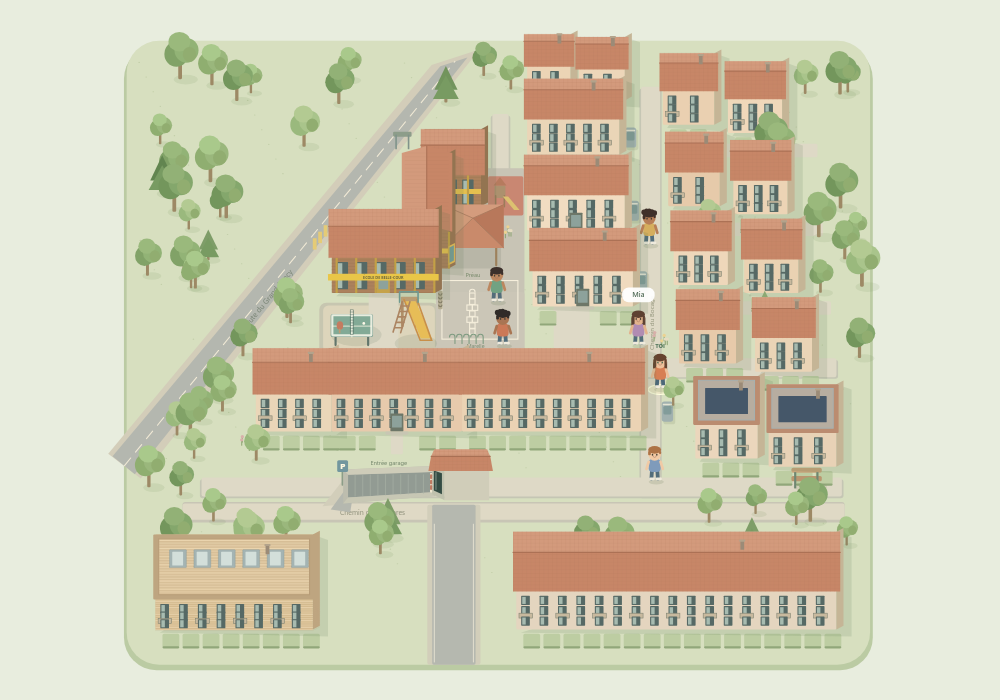

# Les petites aventures du Bocage

Un jeu éducatif dans un quartier illustré inspiré du Bocage à Onex, Genève. Les enfants créent leur personnage et découvrent des activités en se promenant et en discutant avec les habitants.

**[Jouer en ligne](https://r-c-hub.github.io/bocage/)**



## Jouer

- Flèches, ZQSD ou WASD : se déplacer. Des boutons directionnels sont aussi disponibles à l’écran.
- Sur téléphone ou tablette : posez le doigt sur la carte et faites-le glisser pour marcher (joystick virtuel ; plus on glisse loin, plus on va vite). La vue est rapprochée et suit le personnage. Le grand bouton vert indique avec qui parler ou dans quel lieu entrer.
- **E ou Entrée** : parler, jouer ou entrer, en étant à proximité.
- **Échap** : fermer un dialogue.
- Le préau permet d’entrer dans l’école. Les nouvelles pièces se trouvent dans son couloir.

Le jeu reste entièrement exploratoire : pas de liste de missions préaffichée ni de déplacement automatique.

## Activités

Personnage personnalisable et difficulté de 7 à 12 ans ; orientation, lecture de l’heure, durées et calculs ; anglais, allemand et italien ; jeu de passes avec les vrais personnages ; marelle ; bibliothèque avec histoires, coloriages sauvegardés, puzzles et révisions ; basket et mouvements ; piano, mélodies et rythmes.

Les histoires, les personnages et les intérieurs sont fictifs. Le plan est une interprétation simplifiée à partir de références, pas une cartographie exacte. Aucune photo Google Maps n’est intégrée.

Les données restent dans le navigateur : pseudo, âge, apparence, progression, coloriages, décoration et gamelles du chat. L’espace famille permet l’export et l’import d’une sauvegarde. La partie locale et la partie en ligne utilisent des espaces de stockage distincts ; utilisez l’export/import pour les transférer.

## Développement local

Ouvrez simplement **index.html** dans un navigateur en conservant **game.js** et **style.css** à côté. Aucun serveur, compte ou dépendance n’est nécessaire pour jouer.

Avec Node.js :

```sh
npm start
```

Contrôles et fichier autonome :

```sh
npm install
npm run check
npm test
npm run bundle
```

Les 52 contrôles utilisent un DOM simulé et une véritable implémentation Canvas. Ils ne remplacent pas une vérification des sons, des animations et du rendu dans chaque navigateur. Le fichier autonome est généré dans **outputs/Le-Bocage.html**.

## Publication

Site statique servi depuis la racine de la branche **main**, avec GitHub Pages. Le fichier **.nojekyll** désactive le traitement Jekyll. Un push sur main met à jour le jeu publié.

[Guide complet](docs/GUIDE.md)

## Nouveautés 2.1

- Voie privée et stationnement entre la route du Grand-Lancy et l’école, d’après routes.png.
- Boutons piétons des deux côtés : E ou Entrée à proximité, attente de l’arrêt des voitures, puis dix secondes de vert. Hors du passage, la chaussée est bloquée avec un avertissement. Une traversée déjà engagée peut se terminer ; les voitures restent arrêtées jusqu’à sa fin. Le temps de jeu est suspendu dans les dialogues.
- Parc de l’autre côté : balançoire, cabane avec toboggan, tourniquet, de droite à gauche. Chaque jeu propose une petite animation avec le personnage.
- Chez soi : approchez-vous de « Décorer ta chambre ». Ajoutez des meubles et jouets, choisissez leur couleur et placez-les sur les cases libres ; les couloirs restent dégagés. La décoration se sauvegarde automatiquement.
- Moustache vit chez soi : approchez-vous du chat pour servir des croquettes ou remplir sa gamelle d’eau. Les gamelles et la décoration sont incluses dans l’export/import.
- Zoom borné entre la vue globale et la vue proche centrée sur le personnage.
- Ping-pong et toboggan de la cour intervertis ; questions d’heure au format 24 h avec indication du moment de la journée.


### Animations du parc

Les trois jeux ont des scènes animées dessinées : balançoire avec chaînes fixées à la barre, siège et personnage articulé ; cabane avec montée de l’échelle, installation, glissade courbe et arrivée ; tourniquet en perspective avec le personnage et Sami, barres et plateau tournants. Les vêtements, cheveux, peau et yeux reprennent le personnage choisi. Chaque animation propose Pause, Reprendre et Recommencer.


La balançoire et le tourniquet se pilotent en continu : cliquez pour donner une impulsion, ou maintenez le bouton ↑ pour prendre de l’élan / accélérer. Le bouton ↓ freine. Les touches ↑ et ↓ fonctionnent aussi. Sans action, le mouvement ralentit naturellement ; la jauge indique l’élan / la hauteur ou la vitesse. Pause conserve la position ; Recommencer remet le jeu au départ.


### Marelle interactive

La marelle propose un lancer de précision avec une zone adaptée à l’âge, des sauts à cloche-pied et à deux pieds sur les cases doubles, puis un retour avec ramassage du caillou. Cliquez sur le plateau ou les boutons numérotés ; les touches 1 à 8 sélectionnent aussi une rangée. Espace ou Entrée lance le caillou et permet de le ramasser. Les indices sont activables, et affichés au départ pour les 7–8 ans. Chaque nouvelle partie change la case du caillou.
